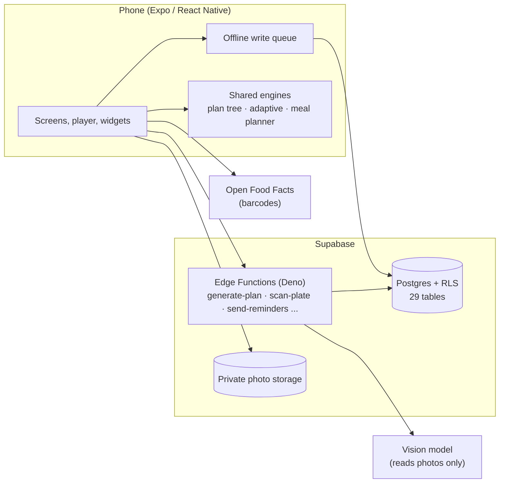

<div align="center">


# CLAWW

**One app for workouts, food, steps and sleep. It plans every day for you and gets a little smarter each time you use it.**

[](https://claww.me)


<br />


</div>

<br />

## What is CLAWW?

Most fitness apps are a logbook: you type, they store. CLAWW does the thinking.

It builds a training plan that fits your goal, equipment and week, and **rewrites the next session after every workout**: more weight when you earned it, a lighter day when your legs are sore, an easier plan when you slept badly. It plans your meals from foods you can actually get (a hostel mess, a tiffin, a home kitchen), reads a photo of your plate, and shows everything in one calm place.

Built in India, for Indian food and Indian gyms, with a barbell-clean design.

> **Status:** pre-launch. The Android app is in testing; the waitlist is open at **[claww.me](https://claww.me)**. Android first, iOS next.

<br />

## Screens

<table>
  <tr>
    <td align="center"><br /><sub><b>Today</b><br />rings, session, one-tap water</sub></td>
    <td align="center"><br /><sub><b>Train</b><br />your week and today's session</sub></td>
    <td align="center"><br /><sub><b>Workout player</b><br />dials, rest timer, last time</sub></td>
    <td align="center"><br /><sub><b>Check your meal</b><br />every item editable</sub></td>
  </tr>
  <tr>
    <td align="center"><br /><sub><b>Muscle recovery</b><br />a score for every muscle</sub></td>
    <td align="center"><br /><sub><b>Quick log</b><br />scan, food, water, sleep</sub></td>
    <td align="center"><br /><sub><b>Week review</b><br />the coach's marks, keep or undo</sub></td>
    <td align="center"><br /><sub><b>Your kitchen</b><br />plans from what you can get</sub></td>
  </tr>
</table>

<br />

## Features

### Train
- **Plans from a tree, not a guess.** 19 reviewed plan blueprints across goal (muscle, fat loss, strength, general), place (gym, home, no equipment) and 2 to 6 days a week, filled from a catalogue of **183 exercises** with metadata and written form guides. Training styles and *Easy / Standard / Hard* on top.
- **An adaptive engine.** After each session it decides the next one: add weight or reps, hold, or reduce. It reads reps-in-reserve, sleep, protein, soreness and time since you last trained each muscle. Every threshold is in one config and covered by tests.
- **A player built for speed.** Ruler dials for weight and reps, warm-up sets and plate maths for barbell lifts, a rest timer set by exercise role (150 / 90 / 60 s), swap an exercise when the equipment is taken, timer and distance modes for cardio, yoga and mobility.
- **Lock-screen control (Android).** A custom Kotlin module draws a live rest countdown in the notification and lets you tick sets without opening the app.
- **The Coach's Pen.** When the plan changes, you see what changed and why, in the coach's handwriting, and can keep it or *use my old plan* with one tap. A weekly review lists every mark.

### Food
- **Daily meal plans from your real kitchen.** 163 meal templates compiled from a food database of USDA ingredients and Indian dishes; a deterministic planner fits your calories and protein and re-plans the rest of the day when you eat something else.
- **Four ways to log.** Search the food database (household units: katori, roti, cup), describe a meal in words, **scan a plate**, or scan a **barcode**. Every result is shown item by item and is editable before it is saved.
- **Honest numbers.** Cooking oil is shown as its own line; unmatched foods are flagged instead of guessed; values still under review are labelled as such.
- **Time-aware.** A quick catch-up for missed meals and a night-close nudge, so a busy day still ends with a complete diary.
- Diary with micronutrients, a rating per meal and one-tap *usuals*.

### Progress
- Strength trends, muscle recovery map, weekly sets per muscle, a 12-week consistency grid, personal bests and a plain-language insight, all drawn with Skia.
- **One streak:** plan days followed (rest days count; an *exam week* switch protects it).
- Steps from Health Connect, sleep and water logging, Android widgets for rings, steps and water.

### Built to be trusted
- **The language model never computes numbers.** Calories, sets, weights and recovery come from deterministic, tested code; a model only reads photos and names foods, and its output is validated and clamped.
- **Offline-first logging.** Meals, water, sleep and sets are written to the phone first and sent when a connection returns, with ids that make a retry impossible to double-count.
- **Privacy by design.** Row-level security on every table, private photo buckets, in-app data export and account deletion, a medical disclaimer that must be acknowledged.

<br />

## How it works



The same TypeScript engines (`plan tree`, `adaptive`, `meal planner`, `scan maths`) run on the phone and in the Edge Functions, so a number shown on screen is the number the server would compute.

<br />

## Tech stack

| Area | Tools |
|---|---|
| App | Expo SDK 54, React Native 0.81, React 19, TypeScript, expo-router |
| Motion and gestures | Reanimated 4, Gesture Handler, haptics |
| Charts and rings | Skia |
| Backend | Supabase: Postgres with row-level security, Auth, Storage, Edge Functions (Deno) |
| Native (Android) | Kotlin modules for the lock-screen session notification and haptics; home-screen widgets |
| Data | USDA FoodData Central, hand-built Indian dishes and meal templates, Open Food Facts (barcodes) |
| Quality | Vitest (96 files, 1,034 tests), strict TypeScript, screen-reader labels on controls |
| Delivery | EAS Build (Android APK and app bundle) |
| Website | Vite, React 19, three.js and GSAP, hosted on Vercel |

<br />

## Repository map

```
.
├── claww app/
│   ├── app/                 Expo app: screens (app/), components/, lib/ (logic), modules/ (Kotlin), widgets/
│   ├── supabase/functions/  Edge Functions and the shared engines (_shared/)
│   ├── database/            schema.sql (idempotent), seeds, food and meal-template sources
│   ├── website/             The landing page at claww.me (Vite + three.js)
│   ├── showreel/            Remotion project for the promo video
│   └── docs/                Plans, test reports, audits, legal drafts, design boards, screenshots
├── LICENSE
└── README.md
```

<br />

## The website

[**claww.me**](https://claww.me) is a single scrolling story: a 3D barbell that gets heavier as each part of the app is explained. It starts at 20 kg and ends at 62.5 kg, the same number the app prescribes in its bench-press example. The waitlist runs on a Supabase Edge Function with confirmation emails.

<div align="center">
  
</div>

The code is in [`claww app/website`](claww%20app/website) (design notes in [`DESIGN.md`](claww%20app/website/DESIGN.md)).

<br />

## Run it locally

You need Node 18+, an Android phone or emulator, and your own Supabase project.

```bash
cd "claww app/app"
cp .env.example .env        # add your Supabase URL and anon key
npm install
npx expo start --dev-client # needs an EAS development build for the native modules
```

```bash
npm test                    # 96 files, 1,034 tests
npx tsc --noEmit            # strict typecheck
```

Backend: apply `claww app/database/schema.sql` (safe to re-run), then deploy functions with `npx supabase functions deploy <name>`. Full steps are in [`claww app/docs/setup.md`](claww%20app/docs/setup.md). The app will not run end to end without your own Supabase project and model keys.

<br />

## Roadmap

- [x] Adaptive plans, player, Coach's Pen, meal planner, plate scanner, barcode, widgets, offline queue
- [x] Landing page and waitlist
- [ ] Closed test (12 testers for 14 days), Play Store listing
- [ ] Nutritionist and trainer review of food values, plan blueprints and injury rules
- [ ] iOS: Live Activity, HealthKit
- [ ] Telugu and Hindi

Everything still open is tracked in [`claww app/docs/open-items.md`](claww%20app/docs/open-items.md), and the latest full audit is in [`claww app/docs/full-audit-2026-11-15.md`](claww%20app/docs/full-audit-2026-11-15.md).

<br />

## The team

CLAWW is built by three co-founders.

| | |
|---|---|
| **Mamidela C S Kasyapa**, Co-founder and CEO | Product and engineering; built the full app |
| **P Chaithanya**, Co-founder | Strategy and marketing |
| **Vamsi**, Co-founder | Engineering quality |

<br />

## License

CLAWW is **source-available, not open source**. You are welcome to read the code and review the work; you may not use, copy or redistribute it without permission. See [`LICENSE`](LICENSE). To ask for permission, write to **crew@claww.me**.

## Credits and data sources

- **USDA FoodData Central** (SR Legacy), public domain: ingredient nutrition.
- **Open Food Facts** (ODbL): barcode look-ups at run time. Product data © Open Food Facts contributors.
- **Fonts:** Inter, Bricolage Grotesque and Caveat (SIL Open Font License) in the app; Archivo on the website.
- Libraries are used under their own open-source licenses (MIT, Apache 2.0 and others).
- Food values and plans are for general wellbeing and are not medical advice.
